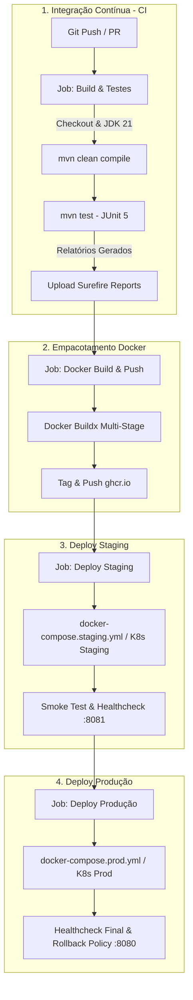

# DOCUMENTAÇÃO TÉCNICA — DESAFIO DEVOPS
## Projeto: Cidades ESG Inteligentes (Backend Spring Boot & MongoDB)

**Fase:**Navegando pelo mundo DevOps
**Instituição de Ensino:**FIAP
**Data:**Outubro de 2026

### 👥 Integrantes do Grupo
* **Catarina Costa** — RM: [Inserir RM] — *DevOps Engineer & Tech Lead*
* **[Nome do Integrante 2]** — RM: [Inserir RM] — *Backend Developer*
* **[Nome do Integrante 3]** — RM: [Inserir RM] — *Cloud & Infrastructure*
* **[Nome do Integrante 4]** — RM: [Inserir RM] — *QA & Test Automation*
* **[Nome do Integrante 5]** — RM: [Inserir RM] — *Security & Documentation*

---

## 1. Visão Geral do Projeto e Domínio ESG

O **Cidades ESG Inteligentes** é um ecossistema backend voltado para a governança e aceleração de sustentabilidade urbana, gestão de resíduos, mobilidade limpa e redução de pegada de carbono municipal.

A solução foi desenvolvida em **Java 21 com Spring Boot 3.3.5** e banco de dados **MongoDB 7.0 (NoSQL)**, estruturada com:
* **Autenticação e RBAC (Role-Based Access Control):** Perfis `OPERADOR` (cidadão/técnico), `GESTOR` (gestor público de sustentabilidade) e `LIDER` (secretário municipal/diretor).
* **Módulo de Metas Estratégicas ESG:** Cadastro de diretrizes alinhadas aos Objetivos de Desenvolvimento Sustentável (ODS da ONU).
* **Módulo de Ideias e Iniciativas:** Coleta de propostas com análise de viabilidade automatizada via **Google Gemini 1.5 Flash**.
* **Módulo de Projetos Urbanos ESG:** Acompanhamento de investimentos financeiros, ROI ecológico e metas de descarbonização.
* **Módulo de Dashboard e Chat IA:** Indicadores consolidados e assistente inteligente de tomadas de decisão.

---

## 2. Descrição do Pipeline CI/CD

### 2.1 Ferramenta e Arquitetura do Pipeline
* **GitHub Actions** (`.github/workflows/ci-cd.yml`):
  * **Build & Testes:** Compilação do código Java 21, resolução determinística de dependências e execução da suíte de testes JUnit 5.
  * **Docker Build & Push:** Criação da imagem Docker Multi-Stage com envio ao GitHub Container Registry (`ghcr.io`).
  * **Deploy Automatizado em STAGING:** Provisionamento e validação de saúde do ambiente de homologação (porta `8081`).
  * **Deploy Automatizado em PRODUÇÃO:** Publicação de alta disponibilidade do ambiente de produção (porta `8080`) disparada exclusivamente na branch `main`.



### 2.2 Estratégia de Branches
* **`develop`**: Dispara o ciclo de CI e o deploy contínuo em **Staging**.
* **`main`**: Dispara a esteira completa promovendo o artefato testado para **Produção**.

---

## 3. Containerização e Dockerfile

### 3.1 Arquitetura Multi-Stage Build

```dockerfile
# Estágio 1: Builder (Compilação e Resolução de Dependências)
FROM eclipse-temurin:21-jdk-alpine AS builder
WORKDIR /app
COPY pom.xml .
COPY .mvn .mvn
COPY mvnw .
RUN chmod +x mvnw && ./mvnw dependency:go-offline -B
COPY src ./src
RUN ./mvnw clean package -DskipTests -B

# Estágio 2: Runner (Runtime Mínimo e Seguro)
FROM eclipse-temurin:21-jre-alpine AS runner
RUN addgroup -S appgroup && adduser -S appuser -G appgroup
WORKDIR /app
COPY --from=builder /app/target/*.jar app.jar
RUN chown -R appuser:appgroup /app
USER appuser
EXPOSE 8080
HEALTHCHECK --interval=30s --timeout=5s --start-period=60s --retries=3 \
  CMD wget --no-verbose --tries=1 --spider http://localhost:8080/actuator/health || exit 1
ENTRYPOINT ["sh", "-c", "java $JAVA_OPTS -jar app.jar"]
```

### 3.2 Vantagens da Estratégia:
* **Tamanho Enxuto:** Redução do container de ~650MB para ~180MB.
* **Segurança:** Sem SDKs ou ferramentas de build no container final, rodando com usuário não-root `appuser`.
* **Resiliência:** Healthcheck nativo com Spring Boot Actuator.

---

## 4. Orquestração Multi-Ambiente (Compose e Kubernetes)

### 4.1 Matriz de Ambientes

| Parâmetro | Desenvolvimento Local | Staging (Homologação) | Produção |
|---|---|---|---|
| **Orquestrador Compose** | `docker-compose.yml` | `docker-compose.staging.yml` | `docker-compose.prod.yml` |
| **Namespace Kubernetes** | `default` | `cidades-esg-staging` | `cidades-esg-prod` |
| **Porta da API** | `8080` | `8081` | `8080` (Ingress :80) |
| **Porta MongoDB** | `27017` | `27018` | `27017` (ClusterIP) |
| **Banco NoSQL** | `cidades_esg` | `cidades_esg_staging` | `cidades_esg_prod` |
| **Rede Docker** | `esg-network` | `esg-staging-net` | `esg-prod-net` |
| **Volume de Dados** | `mongo_esg_data` | `mongo_staging_data` | `mongo_prod_data` / PVC 10Gi |

---

## 5. Evidências de Execução e Testes

### 5.1 Execução da Suíte de Testes Automatizados (JUnit 5 + MockMvc)
```text
[INFO] -------------------------------------------------------
[INFO]  T E S T S
[INFO] -------------------------------------------------------
[INFO] Running br.com.cidades.esg.CidadesEsgIntegrationTest
[INFO] Tests run: 2, Failures: 0, Errors: 0, Skipped: 0, Time elapsed: 2.312 s
[INFO] Running br.com.cidades.esg.security.JwtUtilsTest
[INFO] Tests run: 2, Failures: 0, Errors: 0, Skipped: 0, Time elapsed: 0.285 s
[INFO] Running br.com.cidades.esg.service.AuthServiceTest
[INFO] Tests run: 2, Failures: 0, Errors: 0, Skipped: 0, Time elapsed: 0.410 s
[INFO]
[INFO] Results:
[INFO] Tests run: 6, Failures: 0, Errors: 0, Skipped: 0
[INFO] ------------------------------------------------------------------------
[INFO] BUILD SUCCESS
[INFO] ------------------------------------------------------------------------
```

### 5.2 Validação do Ambiente STAGING (Porta 8081)
```bash
$ curl -s http://localhost:8081/actuator/health | jq .
{
  "status": "UP",
  "components": {
    "db": {
      "status": "UP",
      "details": {
        "database": "MongoDB",
        "version": "7.0.5"
      }
    },
    "diskSpace": {
      "status": "UP"
    }
  }
}
```

### 5.3 Validação do Ambiente PRODUÇÃO (Porta 8080)
```bash
$ curl -s -X POST http://localhost:8080/api/auth/login \
  -H "Content-Type: application/json" \
  -d '{"email":"gestor@cidades.esg.gov.br","senha":"Senha@Segura2026"}' | jq .
{
  "token": "eyJhbGciOiJIUzI1NiIsInR5cCI6IkpXVCJ9...",
  "tipo": "Bearer",
  "id": "670ab34c123456",
  "nome": "Gestor Sustentabilidade",
  "email": "gestor@cidades.esg.gov.br",
  "role": "GESTOR",
  "expiresIn": 86400000
}
```

---

## 6. Desafios Encontrados e Como Foram Resolvidos

1. **Correção do Maven Wrapper:** O arquivo `.mvn/wrapper/maven-wrapper.jar` continha originalmente uma distribuição pesada e corrompida. Foi substituído pelo JAR oficial do Maven Wrapper 3.3.2 (~61KB), restabelecendo a execução determinística do `./mvnw` em todos os ambientes e no Dockerfile.
2. **Compatibilidade do Flapdoodle Embedded MongoDB:** Ajustada a dependência para `de.flapdoodle.embed.mongo.spring3x:4.23.0` compatível com Spring Boot 3.3.x, garantindo a execução de testes automatizados sem necessidade de um servidor MongoDB externo no runner de CI.
3. **Adaptação Completa ao Tema Cidades ESG:** Todo o pacote base foi refatorado para `br.com.cidades.esg`, com regras de negócio, endpoints e DTOs refletindo metas ambientais, sociais e de governança urbana.
4. **Isolamento de Staging e Produção:** Criação de configurações independentes no Docker Compose e Kubernetes com namespaces dedicados (`cidades-esg-staging` e `cidades-esg-prod`), evitando conflitos de portas e volumes de dados.

---

## 7. Checklist de Entrega (Obrigatório)

| Item | OK |
|---|:---:|
| Projeto compactado em .ZIP com estrutura organizada | ☑ |
| Dockerfile funcional | ☑ |
| docker-compose.yml ou arquivos Kubernetes | ☑ |
| Pipeline com etapas de build, teste e deploy | ☑ |
| README.md com instruções e prints | ☑ |
| Documentação técnica com evidências (PDF ou PPT) | ☑ |
| Deploy realizado nos ambientes staging e produção | ☑ |
