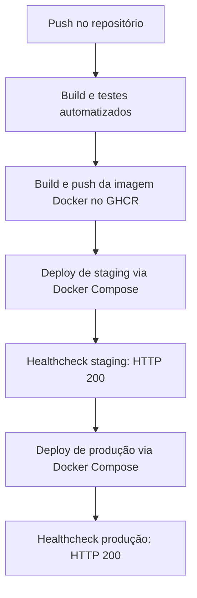

# DOCUMENTAÇÃO TÉCNICA — DESAFIO DEVOPS

## Projeto: Cidades ESG Inteligentes

**Fase:** Navegando pelo mundo DevOps
**Instituição:** FIAP
**Data:** Outubro de 2026
**Integrantes:** Enzo Martini e Catarina Costa
**Repositório:** https://github.com/eMrtc/cidades-esg-devops

---

## 1. Visão geral do projeto

O **Cidades ESG Inteligentes** é uma aplicação backend voltada ao contexto de sustentabilidade e governança urbana. O projeto utiliza **Java 21**, **Spring Boot 3.3.5** e **MongoDB 7**, com autenticação baseada em JWT e funcionalidades relacionadas ao domínio ESG.

O objetivo deste desafio é aplicar práticas de DevOps ao ciclo de vida da aplicação: compilação, testes, construção e publicação da imagem Docker e validação automatizada dos ambientes de homologação (*staging*) e produção.

---

## 2. Pipeline CI/CD

### 2.1 Ferramenta e fluxo

O pipeline está configurado no **GitHub Actions**, no arquivo `.github/workflows/ci-cd.yml`, e foi validado na **execução #7 — “Melhoria de código e texto”**, concluída com sucesso.



As quatro etapas verificadas foram:

1. **Build e testes:** preparação do Java 21, compilação Maven e execução dos testes automatizados.
2. **Docker Build & Push:** construção da imagem por meio do Docker e publicação no GitHub Container Registry (GHCR).
3. **Staging:** provisionamento com `docker-compose.staging.yml` e verificação de `http://localhost:8081/actuator/health`.
4. **Produção:** provisionamento com `docker-compose.prod.yml` e verificação de `http://localhost:8080/actuator/health`, após aprovação do estágio anterior.

**Importante:** os ambientes foram iniciados e testados nos *runners temporários* do GitHub Actions. Os resultados comprovam o deploy e o funcionamento durante a execução do workflow, mas **não comprovam hospedagem pública contínua**. Os manifests Kubernetes presentes no projeto são configurações adicionais e não foram apresentados como um cluster efetivamente implantado.

### 2.2 Evidência do pipeline


---

## 3. Containerização

### 3.1 Dockerfile multi-stage

O `Dockerfile` utiliza dois estágios:

- **Builder:** imagem `eclipse-temurin:21-jdk-alpine`, Maven Wrapper e código-fonte para produzir o JAR.
- **Runner:** imagem `eclipse-temurin:21-jre-alpine`, contendo a aplicação compilada, sem ferramentas de build, com execução por usuário não-root.

A configuração inclui a porta interna `8080`, variáveis de execução Java e healthcheck pelo Spring Boot Actuator.

**Comandos utilizados no processo:**

```bash
docker compose up --build -d
docker compose ps
docker compose down
```

Para ver o Dockerfile integral, consulte o arquivo `Dockerfile` na raiz do projeto. A construção da imagem foi validada pela etapa **Build & Push da Imagem Docker** no GitHub Actions.

---

## 4. Orquestração dos serviços

O projeto disponibiliza arquivos Docker Compose para três contextos:

| Contexto | Arquivo | Porta HTTP da aplicação |
|---|---|---|
| Desenvolvimento | `docker-compose.yml` | Conforme mapeamento local do arquivo |
| Staging | `docker-compose.staging.yml` | `8081` |
| Produção | `docker-compose.prod.yml` | `8080` |

O Compose organiza a aplicação Spring Boot e o MongoDB com configurações de ambiente, redes e volumes para persistência dos dados durante a vida útil do ambiente correspondente.

A pasta `kubernetes/` contém manifests para staging e produção, incluindo recursos de configuração, armazenamento e implantação. **A execução automatizada demonstrada nesta entrega usa Docker Compose**, e não um cluster Kubernetes.

O segredo JWT de produção é fornecido ao workflow por meio do secret do repositório `JWT_SECRET_PROD`, evitando publicar o valor real no código. O arquivo `.env` local não deve integrar o ZIP nem ser versionado.

---

## 5. Evidências de execução

### 5.1 Build e testes automatizados

A suíte Maven/JUnit foi executada com o resultado confirmado de **6 testes, 0 falhas e 0 erros**, com **BUILD SUCCESS**. O job correspondente também concluiu com sucesso na execução #7 do GitHub Actions.

Os relatórios dos testes podem ser consultados na etapa de build do workflow e nos artefatos correspondentes, quando disponíveis.

### 5.2 Staging — porta 8081


A etapa **Smoke Test & Healthcheck Real em Staging** registrou:

```text
Healthcheck Staging OK! Status HTTP 200 recebido.
```

A resposta do endpoint `/actuator/health` indicou `status: UP`, incluindo o componente MongoDB com status `UP`.

### 5.3 Produção — porta 8080


A etapa **Smoke Test & Healthcheck Real em Produção** registrou:

```text
Healthcheck Produção OK! Status HTTP 200 recebido.
```

A resposta do endpoint `/actuator/health` indicou `status: UP`, incluindo o componente MongoDB com status `UP`.

**Escopo da evidência:** as capturas demonstram que os serviços responderam corretamente durante os deploys automatizados nos runners do GitHub Actions. Não foi apresentada evidência de disponibilidade pública permanente ou de um teste de login autenticado em produção.

---

## 6. Desafios encontrados e soluções

1. **Execução do Maven Wrapper no Windows:** houve dificuldade de execução do wrapper no PowerShell. A execução local dos testes foi viabilizada com a chamada explícita à classe do Maven Wrapper via Java 21.
2. **MongoDB embarcado nos testes:** a versão `6.0.14` foi configurada para o Flapdoodle no ambiente de testes, permitindo a execução da suíte.
3. **Incompatibilidade entre dependências:** a falha de testes no CI relacionada a `commons-compress` e `commons-lang3` foi resolvida com a declaração explícita de `commons-lang3` versão `3.17.0` no escopo de testes.
4. **Segredo JWT em produção:** o workflow inicialmente falhou ao iniciar o ambiente de produção sem o segredo necessário. Foi configurado o secret `JWT_SECRET_PROD` no GitHub Actions e o Compose passou a exigir o valor no ambiente.
5. **Validação automatizada dos dois ambientes:** foram configurados deploys via Docker Compose e verificações de saúde que aguardam a inicialização da aplicação e exigem resposta HTTP 200.
6. **Organização das evidências:** as capturas reais da execução #7 foram incluídas na pasta `evidencias/` e referenciadas pela documentação.

---

## 7. Checklist de entrega (obrigatório)

| Item | Situação |
|---|:---:|
| Projeto compactado em ZIP com estrutura organizada | Concluído |
| Dockerfile funcional | Concluído |
| `docker-compose.yml` ou arquivos Kubernetes | Concluído |
| Pipeline com etapas de build, testes e deploy | Concluído |
| README com instruções e prints | Concluído |
| Documentação técnica com evidências (PDF ou PPT) | Concluído — `APRESENTACAO_DEVOPS_FINAL.pptx` com nove slides e três evidências reais |
| Deploy realizado nos ambientes staging e produção | Concluído — staging e produção validados em runners temporários do GitHub Actions |

**Antes da entrega:** revisar o conteúdo do ZIP atualizado com esta documentação e a apresentação `APRESENTACAO_DEVOPS_FINAL.pptx`. Não incluir `.env` com segredos, `.git/` ou `target/`.
