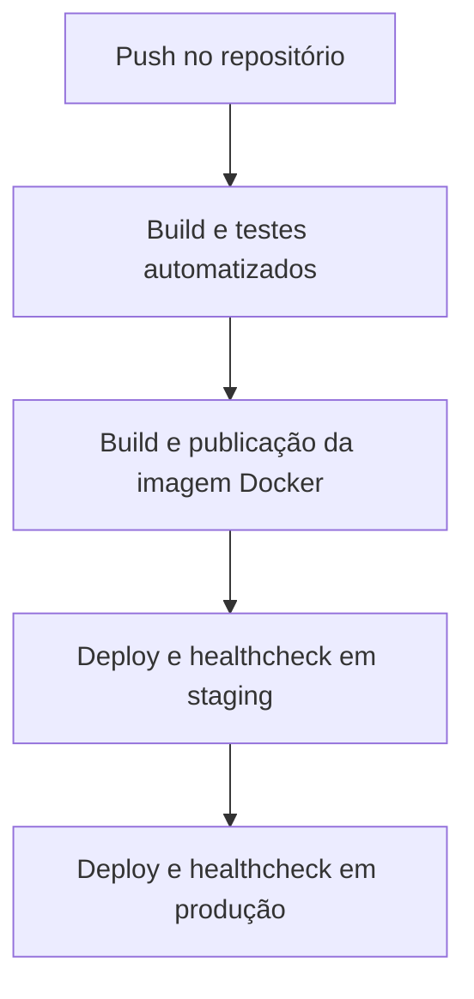
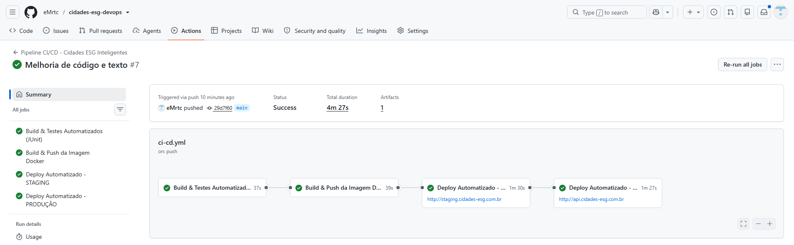
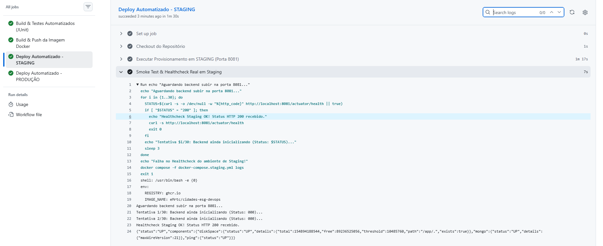
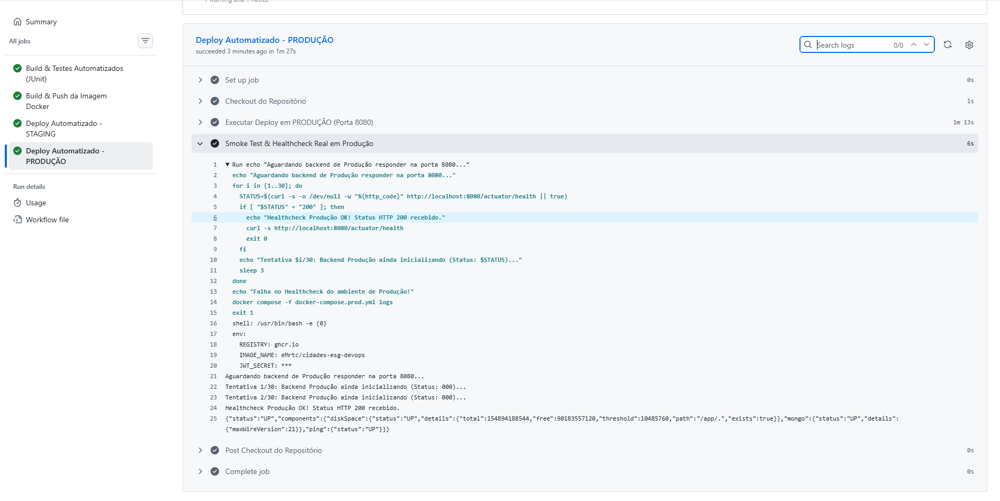

# Projeto - Cidades ESG Inteligentes

**Atividade avaliativa:** Desafio DevOps — Fase "Navegando pelo mundo DevOps" (FIAP)

**Integrantes:** Enzo Martini e Catarina Costa

**Repositório:** https://github.com/eMrtc/cidades-esg-devops

Aplicação backend voltada à gestão de iniciativas ESG e sustentabilidade urbana, desenvolvida em **Java 21**, **Spring Boot 3.3.5** e **MongoDB 7**. O projeto implementa integração e entrega contínuas com **GitHub Actions**, containerização com **Docker** e orquestração com **Docker Compose**. Também contém manifests de **Kubernetes** como alternativa de implantação.

## Sumário

1. [Como executar localmente com Docker](#como-executar-localmente-com-docker)
2. [Pipeline CI/CD](#pipeline-cicd)
3. [Containerização](#containerização)
4. [Orquestração com Docker Compose e Kubernetes](#orquestração-com-docker-compose-e-kubernetes)
5. [Prints do funcionamento](#prints-do-funcionamento)
6. [Tecnologias utilizadas](#tecnologias-utilizadas)
7. [Desafios encontrados e soluções](#desafios-encontrados-e-soluções)
8. [Checklist de entrega](#checklist-de-entrega-obrigatório)

---

## Como executar localmente com Docker

### 1. Pré-requisitos

- Docker Desktop com Docker Compose v2 instalado e em execução.
- Git instalado, caso deseje clonar o repositório.
- Portas disponíveis conforme o mapeamento definido no arquivo `docker-compose.yml`.

### 2. Obter o projeto e configurar o ambiente

```bash
git clone https://github.com/eMrtc/cidades-esg-devops.git
cd cidades-esg-devops
```

Crie o arquivo `.env` a partir de `.env.example`. No PowerShell do Windows:

```powershell
Copy-Item .env.example .env
```

No Linux ou macOS:

```bash
cp .env.example .env
```

Revise os valores do `.env` antes de iniciar, especialmente os segredos JWT e outras configurações sensíveis. **Não publique o arquivo `.env` nem credenciais reais no repositório ou no ZIP.**

### 3. Subir os serviços

```bash
docker compose up --build -d
```

O Compose provisiona o backend Spring Boot e o banco MongoDB, utilizando rede e volume definidos no arquivo de configuração.

### 4. Verificar os containers e a aplicação

```bash
docker compose ps
```

Consulte a porta publicada pelo Compose e teste o endpoint de saúde da aplicação. Por exemplo, se o backend estiver mapeado na porta 8080:

```bash
curl http://localhost:8080/actuator/health
```

Uma resposta saudável contém `"status":"UP"`. Caso a porta local configurada seja `8081`, use `http://localhost:8081/actuator/health`.

### 5. Encerrar os serviços

```bash
docker compose down
```

Para preservar os dados do banco, não utilize `docker compose down -v`, pois a opção `-v` remove volumes associados ao projeto.

---

## Pipeline CI/CD

O pipeline é definido em [`.github/workflows/ci-cd.yml`](.github/workflows/ci-cd.yml) e executado pelo **GitHub Actions**. A execução **#7**, intitulada **"Melhoria de código e texto"**, foi concluída com sucesso, incluindo as quatro etapas abaixo.



### Etapa 1 — Build e testes automatizados

- Preparação do ambiente com Java 21 e Maven.
- Compilação da aplicação.
- Execução dos testes automatizados com JUnit 5 e dependências de teste, incluindo MongoDB embarcado.
- Geração de relatórios de testes pelo Maven Surefire.

### Etapa 2 — Build e publicação da imagem Docker

- Construção da imagem com Docker Buildx, utilizando o `Dockerfile` multi-stage.
- Publicação no **GitHub Container Registry (GHCR)**, conforme a configuração do workflow.
- A etapa seguinte depende do sucesso do build e dos testes.

### Etapa 3 — Deploy automatizado em staging

- Provisionamento dos serviços via `docker-compose.staging.yml` em um runner do GitHub Actions.
- Aplicação acessível internamente no runner pela porta **8081**.
- Smoke test no endpoint `http://localhost:8081/actuator/health`.
- A execução #7 registrou **HTTP 200**, `status: UP` e MongoDB com `status: UP`.

### Etapa 4 — Deploy automatizado em produção

- Execução após o sucesso da etapa de staging, conforme as condições do workflow.
- Provisionamento via `docker-compose.prod.yml` em um runner do GitHub Actions.
- Aplicação acessível internamente no runner pela porta **8080**.
- Smoke test no endpoint `http://localhost:8080/actuator/health`.
- A execução #7 registrou **HTTP 200**, `status: UP` e MongoDB com `status: UP`.
- O segredo JWT de produção é fornecido por um **GitHub Actions Secret**, sem expor seu valor no código.

**Limite da implantação:** staging e produção foram iniciados e testados em **runners temporários do GitHub Actions**. Isso demonstra que os serviços sobem e respondem corretamente durante o pipeline, mas **não equivale a uma hospedagem pública permanente ou a um cluster de alta disponibilidade**. Os endereços de ambiente apresentados no workflow não devem ser interpretados como sites públicos validados.

**Execuções:** [GitHub Actions do projeto](https://github.com/eMrtc/cidades-esg-devops/actions).

---

## Containerização

O `Dockerfile` utiliza a estratégia **multi-stage**, separando o processo de compilação da imagem utilizada para executar a aplicação.

- **Builder:** imagem `eclipse-temurin:21-jdk-alpine`, Maven Wrapper e código-fonte para geração do JAR.
- **Runner:** imagem `eclipse-temurin:21-jre-alpine`, com apenas os componentes necessários para executar a aplicação.
- **Segurança:** execução como usuário não-root (`appuser`).
- **Monitoramento:** `HEALTHCHECK` baseado no endpoint Spring Boot Actuator.

### Conteúdo do Dockerfile

```dockerfile
# Estagio 1: compilacao
FROM eclipse-temurin:21-jdk-alpine AS builder
WORKDIR /app
COPY pom.xml .
COPY .mvn .mvn
COPY mvnw .
RUN chmod +x mvnw && ./mvnw dependency:go-offline -B
COPY src ./src
RUN ./mvnw clean package -DskipTests -B

# Estagio 2: execucao
FROM eclipse-temurin:21-jre-alpine AS runner
RUN addgroup -S appgroup && adduser -S appuser -G appgroup
WORKDIR /app
COPY --from=builder /app/target/*.jar app.jar
RUN chown -R appuser:appgroup /app
USER appuser
EXPOSE 8080
ENV JAVA_OPTS="-Djava.security.egd=file:/dev/./urandom -XX:+UseContainerSupport -XX:MaxRAMPercentage=75.0"
HEALTHCHECK --interval=30s --timeout=5s --start-period=60s --retries=3 \
  CMD wget --no-verbose --tries=1 --spider http://localhost:8080/actuator/health || exit 1
ENTRYPOINT ["sh", "-c", "java $JAVA_OPTS -jar app.jar"]
```

Os testes são executados na etapa de CI; a construção da imagem utiliza `-DskipTests` para não repetir a suíte dentro do Docker build.

---

## Orquestração com Docker Compose e Kubernetes

### Docker Compose

| Arquivo | Finalidade |
|---|---|
| `docker-compose.yml` | Execução local do backend e do MongoDB. |
| `docker-compose.staging.yml` | Ambiente de staging usado no pipeline, com backend na porta 8081. |
| `docker-compose.prod.yml` | Ambiente de produção usado no pipeline, com backend na porta 8080. |

As configurações do Compose definem os serviços, variáveis de ambiente, redes e volumes para o banco de dados. Os volumes permitem persistir dados enquanto os containers são recriados **no mesmo ambiente Docker**.

### Kubernetes

A pasta `kubernetes/` contém manifests de referência para ambientes de staging e produção, incluindo namespaces, ConfigMaps/Secrets, Deployments, Services, volumes persistentes e recursos de rede.

**Observação:** os manifests Kubernetes fazem parte do projeto, mas a execução #7 apresentada como evidência utiliza **Docker Compose**, não um cluster Kubernetes implantado.

---

## Prints do funcionamento

As capturas abaixo correspondem à execução **#7 — Melhoria de código e texto**, concluída com sucesso no GitHub Actions.

### 1. Pipeline CI/CD — quatro jobs aprovados



A imagem mostra as quatro etapas automatizadas concluídas com sucesso: **build e testes**, **build e push da imagem Docker**, **deploy em staging** e **deploy em produção**.

### 2. Staging — healthcheck HTTP 200



O job **Deploy Automatizado - STAGING** executou o smoke test na porta **8081** e registrou:

```text
Healthcheck Staging OK! Status HTTP 200 recebido.
```

A resposta JSON também indicou `status: UP` para a aplicação e para o MongoDB.

### 3. Produção — healthcheck HTTP 200



O job **Deploy Automatizado - PRODUÇÃO** executou o smoke test na porta **8080** e registrou:

```text
Healthcheck Produção OK! Status HTTP 200 recebido.
```

A resposta JSON também indicou `status: UP` para a aplicação e para o MongoDB.

**Nota sobre as evidências:** as capturas comprovam a execução bem-sucedida dos ambientes durante o workflow. Como os runners são temporários, as imagens não comprovam disponibilidade pública contínua após o término do pipeline.

---

## Tecnologias utilizadas

| Categoria | Tecnologia | Utilização |
|---|---|---|
| Linguagem | Java 21 | Desenvolvimento do backend |
| Framework | Spring Boot 3.3.5 | API REST e serviços |
| Banco de dados | MongoDB 7 | Armazenamento de dados |
| Segurança | Spring Security e JWT | Autenticação e autorização |
| Build | Maven Wrapper | Compilação e dependências |
| Testes | JUnit 5, Mockito e Flapdoodle | Testes automatizados |
| Containerização | Docker e Dockerfile multi-stage | Empacotamento da aplicação |
| Orquestração | Docker Compose | Execução de backend e banco |
| Configuração adicional | Kubernetes | Manifests para ambientes separados |
| CI/CD | GitHub Actions | Automação do pipeline |
| Registro de imagens | GitHub Container Registry | Publicação de imagens Docker |

---

## Desafios encontrados e soluções

1. **Execução do Maven no Windows:** foi utilizado um comando alternativo para executar o Maven Wrapper durante a validação local.
2. **Configuração do MongoDB embarcado nos testes:** foi definida a versão compatível do MongoDB para a suíte de testes.
3. **Incompatibilidade de dependências nos testes:** a dependência `commons-lang3` foi ajustada para corrigir uma falha de execução na CI.
4. **Segredo JWT de produção:** foi configurado um secret no GitHub Actions, com validação da variável exigida pelo Compose de produção.
5. **Validação dos ambientes:** foram incluídos smoke tests automáticos que consultam o endpoint Actuator e falham caso a aplicação não retorne HTTP 200.

---

## Checklist de entrega (obrigatório)

| Item | Situação |
|---|---|
| Projeto compactado em `.zip` com estrutura organizada | Concluído |
| Dockerfile funcional | Concluído |
| `docker-compose.yml` ou arquivos Kubernetes | Concluído |
| Pipeline com etapas de build, teste e deploy | Concluído |
| README com instruções e prints | Concluído |
| Documentação técnica com evidências (PDF ou PPT) | Concluído — `APRESENTACAO_DEVOPS_FINAL.pptx` com nove slides e três evidências reais |
| Deploy realizado nos ambientes staging e produção | Concluído — staging e produção validados em runners temporários do GitHub Actions |

**Antes de enviar:** confira se o ZIP contém `Dockerfile`, arquivos Compose, `src/`, `.github/workflows/`, `.env.example`, `README.md`, pasta `evidencias/` e apresentação final. Não inclua `.env` com segredos, `.git/` ou `target/`.
