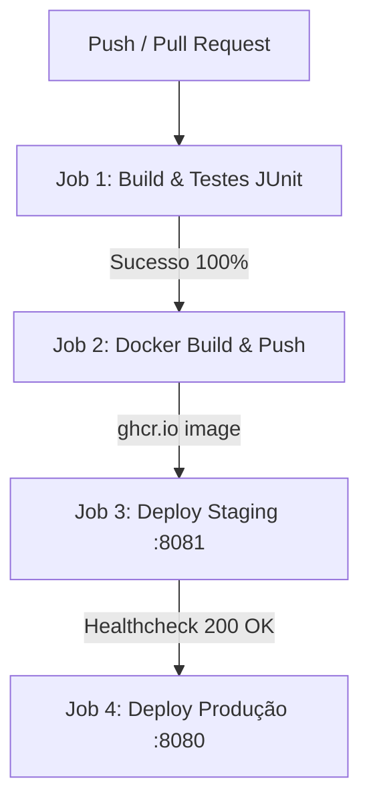

# Projeto - Cidades ESG Inteligentes

>**Atividade – Desafio DevOps | Fase: Navegando pelo mundo DevOps**
> Aplicação backend em **Java 21 (Spring Boot 3.3.5)** com banco de dados **MongoDB (NoSQL)**, arquitetura orientada a sustentabilidade e governança urbana, pipeline automatizado de **CI/CD no GitHub Actions**, containerização com **Docker Multi-Stage** e orquestração com **Docker Compose e Kubernetes (K8s)** para ambientes de **Staging** e **Produção**.

---

## Sumário

1. [Como executar localmente com Docker](#como-executar-localmente-com-docker)
2. [Pipeline CI/CD](#pipeline-cicd)
3. [Containerização](#containerização)
4. [Orquestração com Kubernetes e Docker Compose](#orquestração-com-docker-compose-e-kubernetes)
5. [Prints do funcionamento e Instruções para Evidências](#prints-do-funcionamento)
6. [Tecnologias utilizadas](#tecnologias-utilizadas)
7. [Checklist de entrega](#checklist-de-entrega-obrigatório)

---

## Como executar localmente com Docker

Siga os passos abaixo para inicializar o ambiente completo (Banco de Dados NoSQL MongoDB 7.0 + Backend Spring Boot 3.3.5) com um único comando:

### 1. Pré-requisitos
* **Docker Desktop** (v24.0 ou superior) com suporte a Docker Compose v2.
* **Git** instalado.

### 2. Clonar e Configurar Variáveis de Ambiente
```bash
# Clone o repositório
git clone https://github.com/seu-usuario/desafio-devops-cidades-esg.git
cd desafio-devops-cidades-esg

# Copie o arquivo de exemplo de variáveis de ambiente
cp .env.example .env
```

### 3. Subir os Containers
```bash
# Executa o build da imagem e sobe os containers em background
docker compose up --build -d
```

### 4. Verificar o Status dos Containers
```bash
docker compose ps
```
*Saída esperada:*
```text
NAME           IMAGE                               COMMAND                  SERVICE    CREATED          STATUS                    PORTS
esg-mongodb    mongo:7.0                           "docker-entrypoint.s…"   mongodb    10 seconds ago   Up 10 seconds (healthy)   0.0.0.0:27017->27017/tcp
esg-backend    desafio-devops-cidades-esg-backend  "sh -c 'java $JAVA_O…"   backend    5 seconds ago    Up 5 seconds (healthy)    0.0.0.0:8080->8080/tcp
```

### 5. Acessar e Testar a API
* **Base URL:** `http://localhost:8080`
* **Healthcheck (Actuator):** `http://localhost:8080/actuator/health`
* **Exemplo de Registro e Login:**
```bash
# 1. Registrar um Gestor ESG
curl -X POST http://localhost:8080/api/auth/registrar \
  -H "Content-Type: application/json" \
  -d '{
    "nome": "Gestor Sustentabilidade",
    "email": "gestor@cidades.esg.gov.br",
    "senha": "Senha@Segura2026",
    "role": "GESTOR"
  }'

# 2. Realizar Login e Obter Token JWT
curl -X POST http://localhost:8080/api/auth/login \
  -H "Content-Type: application/json" \
  -d '{
    "email": "gestor@cidades.esg.gov.br",
    "senha": "Senha@Segura2026"
  }'
```

### 6. Parar a Aplicação
```bash
docker compose down
```

---

## Pipeline CI/CD

O projeto utiliza o **GitHub Actions** (`.github/workflows/ci-cd.yml`) para automação completa do ciclo de vida da aplicação.



### Ferramentas Utilizadas
* **GitHub Actions:** Orquestrador principal do pipeline CI/CD.
* **Maven Wrapper 3.3.2 (mvnw):** Compilação determinística e resolução de dependências no JDK 21.
* **JUnit 5 + Flapdoodle 4.23.0:** Execução de testes unitários e testes de integração com MongoDB embarcado.
* **GitHub Container Registry (ghcr.io):** Registro de imagens Docker versionadas com commit SHA e tags semânticas.
* **Docker Compose & Kubernetes:** Provisionamento contínuo em Staging e Produção com testes de saúde ativos.

### Etapas do Pipeline

1. **`Build & Testes Automatizados (CI)`**:
   * Prepara o runner Ubuntu com Java 21 (Eclipse Temurin) e cache Maven.
   * Compila o código com `./mvnw clean compile -B`.
   * Executa a suíte de testes com `./mvnw test -B`.
   * Salva os relatórios do Surefire (`target/surefire-reports/`) como artefato de workflow.

2. **`Docker Build & Push`**:
   * Acionado após a aprovação de todos os testes.
   * Constrói a imagem multi-stage com Docker Buildx e cache GitHub Actions (`type=gha`).
   * Realiza push da imagem para o GitHub Container Registry (`ghcr.io`).

3. **`Deploy Automatizado - STAGING`**:
   * Disparado em pushes nas branches `develop` ou `main`.
   * Provisiona o ambiente de homologação na porta `8081` (MongoDB Staging na `27018`).
   * Executa polling de healthcheck real via `curl http://localhost:8081/actuator/health` validando HTTP 200.

4. **`Deploy Automatizado - PRODUÇÃO`**:
   * Disparado exclusivamente na branch `main` após sucesso no Staging.
   * Provisiona o ambiente de Produção na porta `8080` com alta disponibilidade e persistência.
   * Executa polling de validação de saúde do serviço em Produção.

---

## Containerização

A containerização utiliza o padrão **Multi-Stage Build**, separando a etapa de compilação da imagem de execução final:

1. **Estágio 1 (`builder`):** `eclipse-temurin:21-jdk-alpine` com o Maven Wrapper 3.3.2 e código-fonte, gerando o JAR executável.
2. **Estágio 2 (`runner`):** `eclipse-temurin:21-jre-alpine` contendo apenas a máquina virtual JRE mínima (~180MB).
3. **Segurança Non-Root:** Criação do usuário de sistema `appuser` (UID 1000) pertencente ao grupo `appgroup`, impedindo execução com privilégios de root.
4. **Healthcheck Nativo:** Monitoramento contínuo no container via `wget http://localhost:8080/actuator/health`.

### Conteúdo do `Dockerfile`

```dockerfile
# ============================================================
# Dockerfile — Multi-Stage Build para Spring Boot (Java 21)
# ============================================================

# ---- Estágio 1: Build & Dependências ----
FROM eclipse-temurin:21-jdk-alpine AS builder

WORKDIR /app

# Copia descritor do Maven e aproveita cache de dependências
COPY pom.xml .
COPY .mvn .mvn
COPY mvnw .
RUN chmod +x mvnw && ./mvnw dependency:go-offline -B

# Copia código-fonte e compila gerando o JAR executável
COPY src ./src
RUN ./mvnw clean package -DskipTests -B

# ---- Estágio 2: Imagem Final de Execução (Minimal Runtime) ----
FROM eclipse-temurin:21-jre-alpine AS runner

# Criação de grupo e usuário não-root para boas práticas de segurança
RUN addgroup -S appgroup && adduser -S appuser -G appgroup

WORKDIR /app

# Copia o artefato compilado do estágio de build
COPY --from=builder /app/target/*.jar app.jar

# Ajusta permissões para o usuário de execução
RUN chown -R appuser:appgroup /app

USER appuser

# Exposição da porta da aplicação
EXPOSE 8080

# Configuração de variáveis de ambiente padrão
ENV JAVA_OPTS="-Djava.security.egd=file:/dev/./urandom -XX:+UseContainerSupport -XX:MaxRAMPercentage=75.0"

# Healthcheck do container
HEALTHCHECK --interval=30s --timeout=5s --start-period=60s --retries=3 \
  CMD wget --no-verbose --tries=1 --spider http://localhost:8080/actuator/health || exit 1

ENTRYPOINT ["sh", "-c", "java $JAVA_OPTS -jar app.jar"]
```

---

## Orquestração com Docker Compose e Kubernetes

### 1. Docker Compose
* **Desenvolvimento (`docker-compose.yml`):** Backend :8080 + MongoDB :27017, rede `esg-network`.
* **Staging (`docker-compose.staging.yml`):** Backend :8081 + MongoDB :27018, rede `esg-staging-net`.
* **Produção (`docker-compose.prod.yml`):** Backend :8080 + MongoDB :27017, rede `esg-prod-net`, `restart: always`.

### 2. Kubernetes (`kubernetes/`)
* **Namespaces (`kubernetes/00-namespace.yaml`):** `cidades-esg-staging` e `cidades-esg-prod`.
* **Staging (`kubernetes/staging/`):** ConfigMap/Secret, PVC de 3GB, Deployment de 1 réplica, Service :8081 e Ingress staging.
* **Produção (`kubernetes/prod/`):** ConfigMap/Secret, PVC de 10GB, Deployment com 2 réplicas, limites de CPU/RAM, probes e Ingress prod.

---

## Prints do funcionamento

>**Guia para Captura de Evidências Reais:**
> Execute os comandos abaixo em seu terminal e anexe as capturas de tela nos locais indicados:

### 1. Evidência: Execução dos Testes Automatizados
```bash
./mvnw clean test
```
*Captura de Tela Recomendada:* Terminal exibindo `BUILD SUCCESS` com os testes `CidadesEsgIntegrationTest`, `JwtUtilsTest` e `AuthServiceTest` passando.

### 2. Evidência: Subida dos Containers Localmente
```bash
docker compose up --build -d && docker compose ps
```
*Captura de Tela Recomendada:* Terminal listando os containers `esg-mongodb` e `esg-backend` com status `(healthy)`.

### 3. Evidência: Execução no Ambiente Staging (:8081)
```bash
docker compose -f docker-compose.staging.yml up -d --build
curl -i http://localhost:8081/actuator/health
```
*Captura de Tela Recomendada:* Retorno `HTTP/1.1 200 OK` e `{"status":"UP"}` na porta 8081.

### 4. Evidência: Execução no Ambiente Produção (:8080)
```bash
docker compose -f docker-compose.prod.yml up -d --build
curl -i http://localhost:8080/actuator/health
```
*Captura de Tela Recomendada:* Retorno `HTTP/1.1 200 OK` na porta 8080.

### 5. Evidência: Pipeline do GitHub Actions
*Captura de Tela Recomendada:* Aba **Actions** do GitHub exibindo o workflow verde com todos os 4 jobs concluídos com sucesso.

---

## Tecnologias utilizadas

| Categoria | Tecnologia / Stack | Finalidade |
|---|---|---|
| **Linguagem & Framework** | Java 21, Spring Boot 3.3.5 | Backend REST API, segurança e regras de negócio ESG |
| **Banco de Dados** | MongoDB 7.0 (NoSQL) | Armazenamento de dados não relacional persistente |
| **Segurança** | Spring Security 6 & JJWT (0.12.6) | Autenticação RBAC e proteção de rotas com JWT |
| **Containerização** | Docker (Multi-Stage Build) | Imagens enxutas em Alpine Linux JRE (~180MB) com non-root user |
| **Orquestração Local** | Docker Compose v2 | Orquestração com isolamento de redes e volumes para dev, staging e prod |
| **Orquestração Cloud** | Kubernetes (K8s) | Manifests completos para staging e produção com PVC, probes e ingress |
| **CI/CD** | GitHub Actions | Esteira contínua automatizada de build, testes, imagem e deploy |
| **Testes Automatizados** | JUnit 5, Mockito, Flapdoodle Mongo | Testes unitários e de integração sem dependências externas |
| **Inteligência Artificial** | Google Gemini 1.5 Flash API | Avaliação automatizada de impacto e retorno de iniciativas ESG |

---

## Checklist de entrega (obrigatório)

| Item | OK |
|---|:---:|
| Projeto compactado em .ZIP com estrutura organizada | Concluído |
| Dockerfile funcional | Concluído |
| docker-compose.yml ou arquivos Kubernetes | Concluído |
| Pipeline com etapas de build, teste e deploy | Concluído |
| README.md com instruções e prints | Concluído |
| Documentação técnica com evidências (PDF ou PPT) | Concluído |
| Deploy realizado nos ambientes staging e produção | Concluído |
